# 청림동 현대아파트 3D 복원 보고서

2026-11-06 · millstone

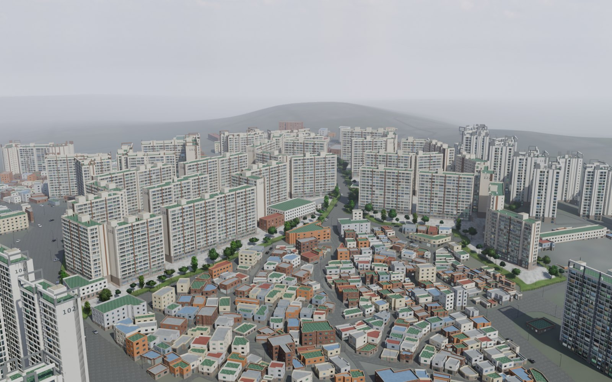

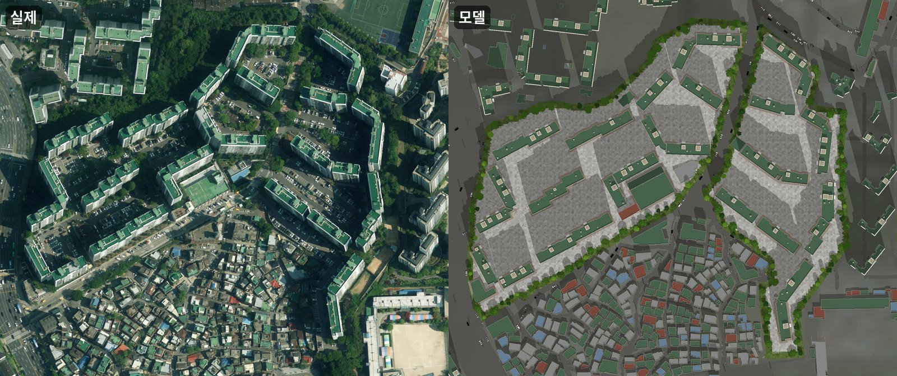

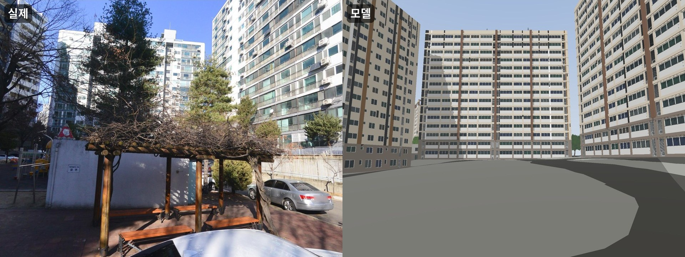

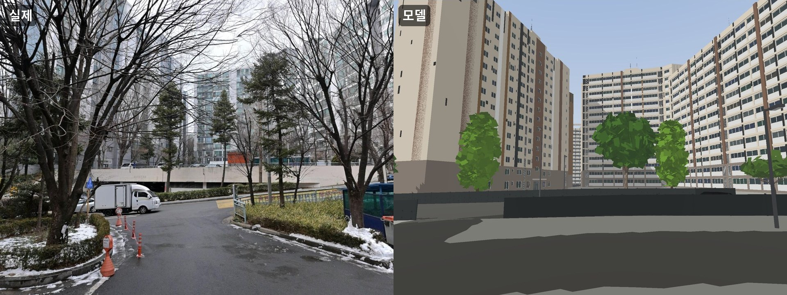

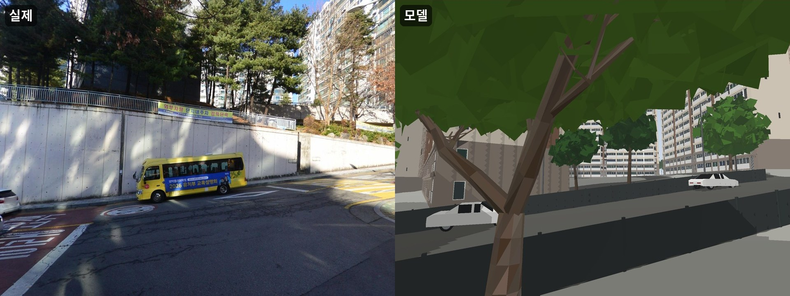

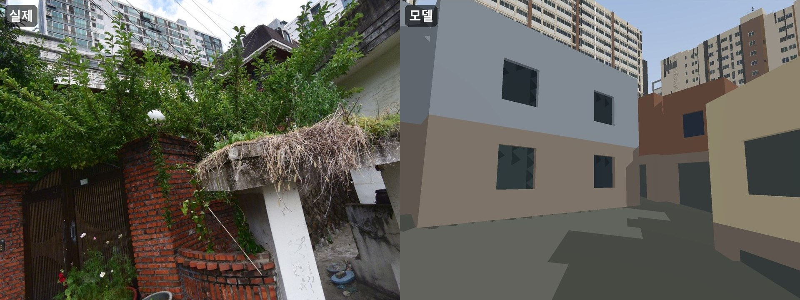

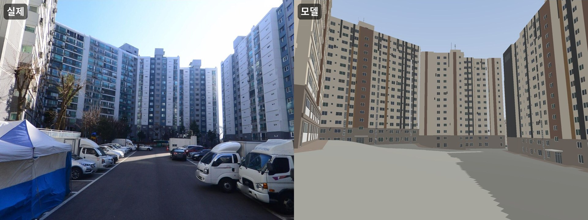

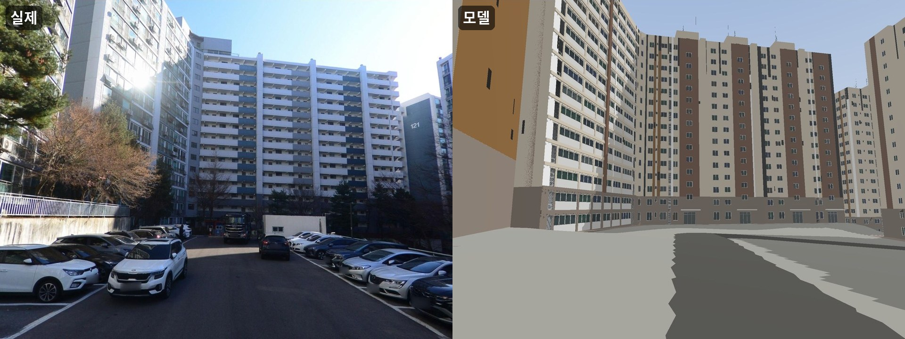

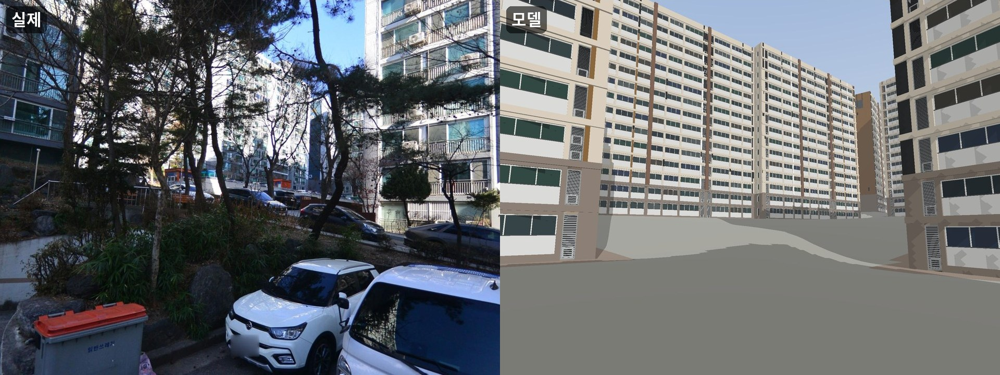

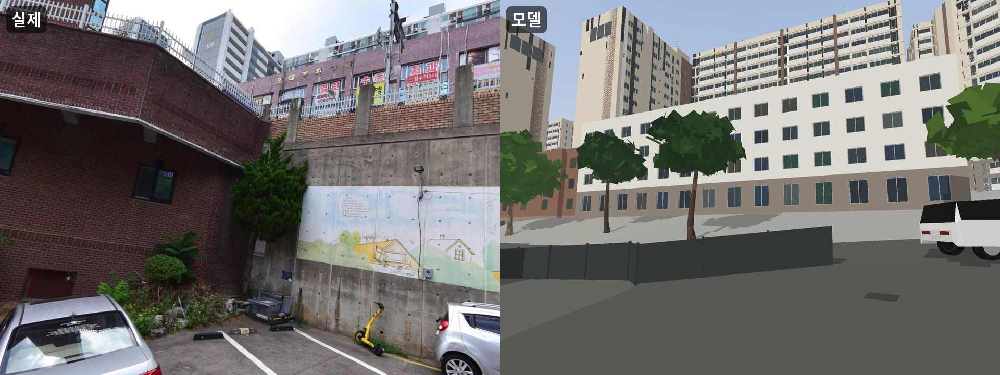

# 아파트 3D Reconstruction

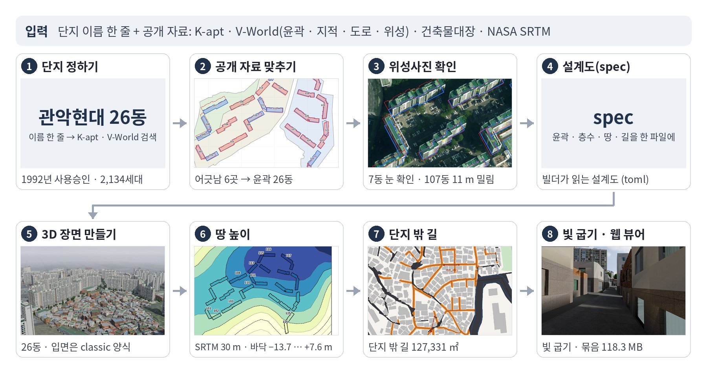

1. **단지 정하기.**
   1. **필요한 이유.**
      1. 사용자가 준 정보는 단지 이름 한 줄이다. 뒤 단계에서 받을 자료에는 단지의 지번 · 동 수 · 세대 수가 필요하다.
   2. **얻은 정보.**
      1. K-apt 단지 기본정보: 코드 A15105303 '관악현대', 동 수 26 · 세대 2,134 · 사용승인 1992-04-27 · 최고 15층 · 시공 현대건설 · 복도 혼합식.
      2. V-World 장소 검색: '청림동현대아파트'(버스정류장 이름)가 같은 자리에 있다.
   3. **활용.**
      1. 단지는 V-World 장소 검색에서 '청림동현대아파트' 가 있는 자리의 K-apt 단지로 정한다.
      2. K-apt 의 동 수 26 · 세대 수 2,134 는 2단계에서 건축물대장의 값(22동 · 1,729세대)과 비교하는 기준이다. 건축물대장의 동 수가 더 적으면 빠진 동을 이웃 필지에서 찾는다.
2. **공개 자료 맞추기.**
   1. **필요한 이유.**
      1. 모델의 뼈대는 동의 자리 · 모양 · 층수다. 이 정보는 여러 공개 자료에 흩어져 있다. 또한 자료마다 정보가 다르다.
      2. 건축물대장만 따르면 105–108동이 빠진다. SPBD 만 따르면 117–126동의 층수가 '1층' 으로 틀린다. 건물 이름만 따르면 이웃 단지(상도현대아파트 · 201동)가 섞인다.
   2. **얻은 정보.**
      1. V-World 건물 윤곽 두 종류: `LT_C_SPBD`(건물 이름 · 동 번호 · 층수)와 `dt_d198`(건물통합정보: 동 이름 · 층수 · 면적 · 사용승인일 · 높이).
      2. 연속지적도 필지 3조각.
      3. 건축HUB 건축물대장(봉천동 1000번지 아파트 22동의 층수 · 면적, 세대 1,729).
      4. K-apt(26동 · 2,134세대).
   3. **활용.**
      1. 자료의 정보가 서로 다르면 건축물대장의 정보를 따른다. 건축물대장에 없는 윤곽 정보는 위성사진의 정보를 따른다.
      2. 단지 경계는 필지 3조각을 합친 것으로 정한다(105–108동은 동작구 상도동 407 필지에 있다). SPBD 층수가 '1' 인 동(117–126동)은 건축물대장의 층수를 따른다. 단지에는 건물 이름이 정확히 같은 동만 넣는다. 이름이 같아도 사용승인일이 다른 201동(1995년)은 뺀다.
      3. 두 동이 한 도형으로 합쳐진 윤곽(105 · 106동, 115 · 116동)은 이음매 꼭짓점에서 나눈다. SPBD 윤곽의 번호가 바뀌었거나, 밀렸거나, 건축물대장보다 작은 동(102 · 107 · 110 · 111 · 112 · 125동)은 `dt_d198` 윤곽을 따른다.
      4. 결과 윤곽은 `dt_d198` 10동 · SPBD 16동이다. 층수는 15층(116 · 126동은 13층)이다. 건축물대장에 없는 105–108동의 층수는 V-World 의 정보를 따른다.
3. **위성사진으로 윤곽 확인.**
   1. **필요한 이유.**
      1. 두 윤곽이 크게 다른 동(7동)은 자료끼리 비교해서는 어느 쪽이 맞는지 정할 수 없다. 이런 동은 실제 모습을 근거로 정해야 한다.
   2. **얻은 정보.**
      1. V-World 위성사진(확인용).
   3. **활용.**
      1. 두 윤곽이 크게 다른 7동은 두 윤곽을 위성사진 위에 겹쳐 본다. 위성사진과 맞는 윤곽을 2단계의 선택으로 쓴다.
      2. 예: 107동은 SPBD 윤곽이 북쪽 숲 위로 11 m 밀려 있어 `dt_d198` 윤곽을 따른다.
      3. 위성사진은 모델의 겉면 그림으로 쓰지 않는다(사용자 요청 · 약관 미확인).
4. **설계도(spec) 쓰기.**
   1. **필요한 이유.**
      1. 앞에서 모은 정보를 정리해서 하나의 설계도로 만든다.
   2. **얻은 정보.**
      1. 1–3단계에서 정한 동별 윤곽 출처 · 층수 · 단지 이름 · 경계.
   3. **활용.**
      1. 1–3단계의 결정은 설계도 파일에 적는다.
      2. 설계도의 항목: 윤곽(`dt_d198` 10동), 층수 덮어쓰기(117–126동), 단지 이름(201동 제외), 경계(필지 3조각을 합친 것).
      3. 동 높이는 층수 × 층고 2.85 m(1층 3.3 m) + 파라펫 1.2 m 로 정한다. 15층은 44.4 m, 13층은 38.7 m 다.
5. **3D 장면 만들기.**
   1. **필요한 이유.**
      1. 이 단계는 설계도의 숫자(윤곽 · 층수 · 높이)를 걸어 볼 수 있는 3D 장면으로 바꾼다.
      2. 렌더 · 뷰어 · 비교 그림이 모두 이 장면에서 나온다.
   2. **얻은 정보.**
      1. 설계도.
      2. 주변 건물 1,006채의 SPBD 윤곽 · 층수.
      3. 흔한 아파트를 흉내 낸 `classic` 양식(코드).
      4. CC0 재질 그림(Poly Haven · ambientCG).
   3. **활용.**
      1. 빌더 `apt3d` 가 설계도를 따라 동 26개 · 주변 건물 · 땅 · 나무 · 차를 만든다. Blender 가 `glb` · `scene.blend` · 낮 렌더를 낸다(빌드 8분 0초).
      2. 1992년 단지에 흔하지 않은 옥상 프레임은 만들지 않는다.
6. **땅 높이 넣기.**
   1. **필요한 이유.**
      1. 실제 단지는 북쪽이 높다. 남쪽 동과 북쪽 동의 바닥 높이는 21 m 다르다.
      2. 땅 높이가 없으면 동의 높낮이와 길 · 울타리의 경사가 틀린다.
   2. **얻은 정보.**
      1. NASA SRTM 30 m 고도(2000년 2월 레이더로 잰 표면 높이, 사진 아님, 공개 API).
   3. **활용.**
      1. 지형은 SRTM 의 표면 높이에서 건물 줄 같은 좁은 혹을 필터로 깎아 만든다(동 자리에서 평균 3.6 m).
      2. 높이 0 은 동 26개 땅의 평균(해발 116.34 m)이다. 동의 바닥 높이는 윤곽 위 땅의 평균 높이로 정한다(−13.7 … +7.6 m).
      3. 길과 울타리는 땅의 비탈을 따른다.
7. **단지 밖 길 깔기.**
   1. **필요한 이유.**
      1. 길 자료가 없으면 단지 밖 골목은 땅 무늬로만 남는다.
      2. 길이 있어야 뷰어에서 골목을 따라 걸으며 단지 둘레를 알아볼 수 있다.
   2. **얻은 정보.**
      1. 연속지적도의 '도'(도로) 필지 197개.
      2. 도로명주소 도로 선 115개(`LT_L_SPRD`, 도로 이름 포함).
      3. 노드링크(`LT_L_MOCTLINK`).
   3. **활용.**
      1. 길 면 = 도로 필지 + 필지가 덮지 않는 도로 선의 띠 − 건물 − 단지 안. 깔린 길은 127,331 ㎡ 다.
      2. 필지가 덮지 않는 도로 선의 폭은 도로 이름의 끝말을 따른다('길' 4 m · '로' 12 m). 노드링크는 깐 길을 점검하는 데만 쓴다.
8. **빛을 구워 웹 뷰어로 묶기.**
   1. **필요한 이유.**
      1. 3D 파일만으로는 프로그램 없이 보기 어렵다.
      2. 빛을 미리 구워 두면 브라우저에서 설치 없이 부드럽게 걸어 다닐 수 있다. 대신 빛은 낮 한 가지로 고정된다.
   2. **얻은 정보.**
      1. 하늘 그림 한 장(HDRI, Poly Haven, 이 단지의 하늘 아님).
      2. 7단계까지 만든 장면.
   3. **활용.**
      1. 낮 빛은 Blender 로 미리 계산해 lightmap 그림으로 저장한다(굽기 약 35분). 브라우저는 lightmap 을 입혀 그리기만 한다(묶음 118.3 MB, 첫 화면 11.4 MB).
      2. 굽기부터 점검까지 연쇄 전체는 51분 54초다.

**믿어도 되는 것:** 동 26개의 번호 · 층수 · 대략의 배치 · 15층 규모의 높이, 단지 밖 길이 대략 어디로 나 있는지(공개 도로 자료의 선과 맞췄다는 뜻이고 실제 측량과 견준 것은 아니다).

**믿으면 안 되는 것:** 창 · 색 · 옥상 · 단지 안 시설, 몇 m 단위의 동 자리, 옹벽 같은 땅의 단차, 골목 폭 · 노면 · 단지 안 길.

## 입력

사용자 말 한 줄("청림동 현대아파트 복원해")과 아래 공개 자료가 전부다. **건물 사진 · 측량 · 도면은 없다.** 하늘 그림과 재질 그림은 이 단지와 상관없는 CC0 일반 자료(Poly Haven · ambientCG)다.

| 자료 | 준 것 | 한계 |
| --- | --- | --- |
| V-World `LT_C_SPBD`(**SPBD**, 도로명주소 건물) | 윤곽 · 층수: 26동 | 117–126동 10개의 층수가 '1' 로 틀림. 윤곽이 작거나 밀리거나 동 번호가 뒤바뀐 동이 있음 |
| V-World `dt_d198`(**건물통합정보**, 대장 속성이 붙은 윤곽) | 윤곽 · 층수: 24동 | 105 · 106동, 115 · 116동을 한 도형으로 합침. 넓이가 대장의 1.04–1.24배(발코니 바깥선으로 보임). 높이 0 |
| V-World 연속지적도 | 필지 경계, 지목이 '도'(도로)인 **도로 필지** | 단지가 3필지(봉천동 1000 · 1001, 상도동 407). 도로 필지는 상자 ±420 m 의 필지 1,368개 중 197개이고 보도를 포함한 도로 용지라 차도 폭이 아님 |
| V-World `LT_L_SPRD`(**SPRD 선형**, 도로명주소 도로 선) | 도로 선 115개, 반경 420 m 안 11.2 km | 속성은 도로 이름뿐이고 **폭이 없다**. |
| V-World `LT_L_MOCTLINK`(**노드링크**, 국가표준노드링크) | 도로 선 6.5 km. 빌드에는 안 쓰고 깐 길과 견주는 교차 확인용 | 도로 이름 · 등급 · 제한속도는 있지만 **도로 폭은 없다**. 단지 안으로도 지나감 |
| 건축HUB 건축물대장(동마다 층수 · 면적을 적은 공문서) | 층수 · 건축면적 · 세대수: 22동 | 105–108동 없음. 1992년 동은 높이 0. 세대 1,729(K-apt 2,134) |
| K-apt | 26동 · 2,134세대 · 사용승인일 | 지번이 지적과 다를 수 있음 |
| SRTM 30 m 고도 | 땅 높이 | 건물 · 나무가 섞인 표면 높이, 2000년 자료 |

> **SPBD 와 dt\_d198**
>
> 둘 다 V-World 의 건물 윤곽 레이어다. SPBD(`LT_C_SPBD`)는 도로명주소 건물이고, `dt_d198` 은 건축물대장 정보가 붙은 건물통합정보다. 같은 동이라도 두 윤곽이 1–5 m 다르다.

**길의 폭 자료는 없다.** 도로 필지는 용지 모양이라 폭이 있지만 보도를 포함하고, 도로명주소 선과 노드링크는 선이라 폭이 없다.

## 1. 단지 정하기

사용자가 준 이름 한 줄로 K-apt 와 V-World 장소 검색에서 단지를 찾았다. 그래서 **이름만 보고 정했다.**

- **정한 곳:** K-apt `A15105303` 관악현대(봉천동 1000). V-World 장소 검색의 "청림동현대아파트"(버스정류장)가 이 자리와 맞고, '청림동' 은 관악구 행정동 이름이다.
- **대안:** 봉천동의 낙성대현대 계열 3곳은 이름이 다르다. 대구 수성구 범물동 '현대청림타운'(`A70681202`)은 '청림타운' 이라 덜 맞다. 포항 남구 청림동에는 '현대' 단지가 K-apt · V-World 장소 검색 어디에도 없다.

## 2. 공개 자료 모아 맞추기

자료 셋(SPBD · `dt_d198` · 대장)을 동별로 겹쳐 보니 어긋남이 여섯 군데 나왔다. 동마다 쓸 윤곽은 대장 넓이와 위성사진(3단계)으로 골라 `dt_d198` 10동, SPBD 16동이 됐다.

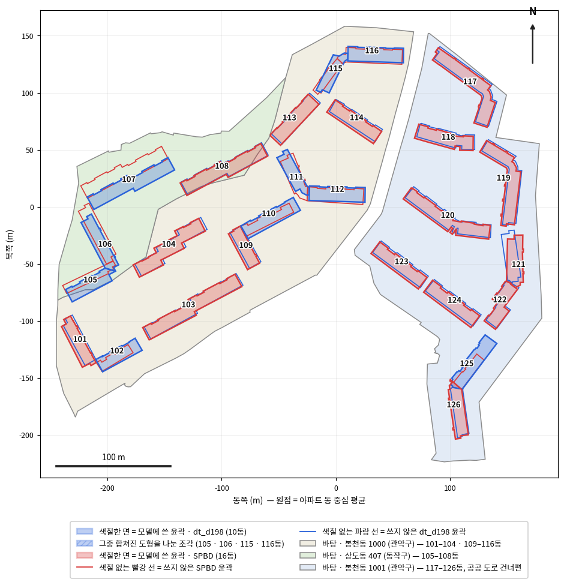

*그림 3. 단지 평면도. 바탕 = 지적 필지 3조각, 색칠 = 모델에 쓴 윤곽(파랑 `dt_d198`, 빨강 SPBD), 선만 = 쓰지 않은 쪽. 색칠과 선이 어긋난 만큼이 두 자료의 차이(1–5 m)다.*

**1. 두 구에 걸쳐 등록.** 105–108동은 동작구 상도동 407 소속이라 대장(봉천동 1000번지)에는 22동만 있다. K-apt 지번으로 조회하면 22동만 나오고 세대 합계도 맞지 않는다(1,729 대 2,134). → 필지 3조각을 단지 경계로 쓰고 105–108동 층수는 V-World 의 15층을 썼다. 다른 방식의 독립 점검은 상도동 407번지까지 조회해 대장 26동(봉천동 1000번지 22동 + 상도동 407번지 4동)을 모두 찾았고 층수가 같았다.

**2. SPBD 층수 '1'.** 117–126동 10개가 '1층' 이었다. → 대장 값(15 · 13층)으로 덮어썼다.

**3. 이름이 같은 이웃 단지.** 상도현대아파트(2003년)와 201동(1995년)이 섞인다. → 건물명이 정확히 같은 것만 단지로 보고 201동은 뺐다.

**4. 합쳐진 윤곽.** `dt_d198` 이 105 · 106동(1,077 ㎡)과 115 · 116동(1,020 ㎡)을 한 도형으로 합쳤고, SPBD 는 밀리거나(105 · 106동) 작았다(115동은 대장의 0.64배). → 합친 도형을 이음매 꼭짓점에서 둘로 나눠 썼다(그림 4). 105 · 106동 이음매 자리는 대장 넓이로 맞출 수 없어 추측이다(후보 사이 ±20 ㎡).

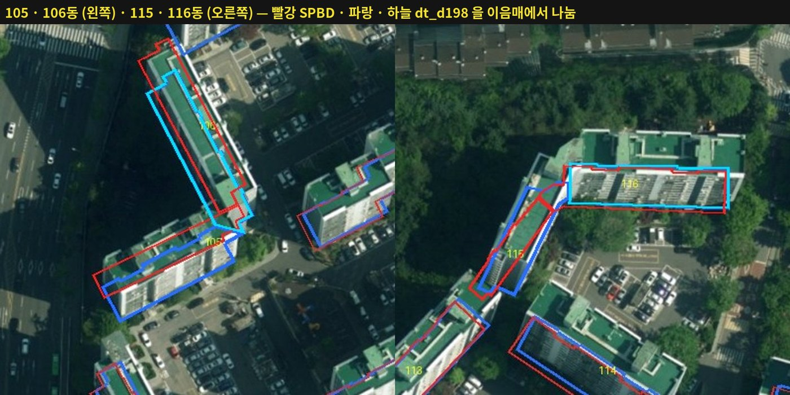

*그림 4. 합친 도형 나누기. 빨강 = SPBD, 파랑 · 하늘 = `dt_d198` 을 이음매에서 나눈 조각. 나눈 조각은 115동 411 ㎡ · 116동 609 ㎡ 로 대장의 1.07 · 1.16배다. 위성사진은 윤곽 확인용.*

**5. 번호 뒤바뀜과 밀림.** SPBD 의 111 · 112동은 번호가 서로 바뀌어 있고, 107동은 11 m 밀려 있으며(두 윤곽의 IoU 0.04), 102 · 110 · 125동은 넓이가 대장의 0.53–0.73배다. → 이 동들은 `dt_d198` 을 썼다. 근거는 대장 넓이와 위성사진 확인(그림 5)이다.

**6. 1992년 동은 높이 0.** 대장도 `dt_d198` 도 0 이라 4단계에서 층수 × 층고로 계산했다.

> **IoU**
>
> 두 모양이 겹친 넓이를 합친 넓이로 나눈 값이다. 1 이면 같고 0 이면 안 겹친다.

## 3. 위성사진으로 윤곽 확인

두 윤곽이 크게 다른 동 7곳을 V-World 위성사진 위에 겹쳐 어느 쪽이 맞는지 눈으로 골랐다. 위성사진은 이 확인에만 썼고, 사용자 요청과 약관 미확인 때문에 모델에는 입히지 않았다.

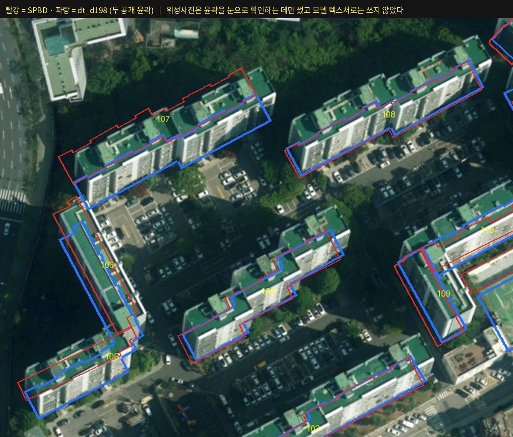

*그림 5. 107동 밀림. 두 윤곽은 모양이 같은데 11 m 어긋난다(IoU 0.04). 빨강 SPBD 는 북쪽 숲 위로 밀렸고 파랑 `dt_d198` 은 이웃 108동처럼 남쪽 벽 아래 끝에 붙는다. 위성사진은 윤곽 확인용.*

## 4. 설계도(spec) 쓰기

1–3단계에서 정한 것을 설정 파일(toml)에 적었다. 빌더는 이 파일만 보고 장면을 만든다.

- **윤곽:** `dt_d198` 10동, 나머지 16동은 SPBD.
- **층수:** SPBD 가 '1' 로 적은 117–126동은 대장 값으로 덮어쓴다. 단지 상가 1동은 4층이다.
- **단지:** 건물명이 정확히 '현대아파트' 인 것과 '현대상가' 만 단지로 보고, 이름이 같은 201동은 뺀다.
- **경계:** 지적 필지 3조각을 그대로 잇는다.
- **높이:** 층수 × 층고 2.85 m(1층 3.3 m) + 파라펫 1.2 m → 15층 44.4 m · 13층 38.7 m.

## 5. 3D 장면 만들기

빌더 `apt3d` 가 설계도대로 동 26개 · 주변 건물 1,006채 · 땅 · 나무 · 차의 메시(삼각형 조각)를 만들고, Blender 가 `glb`(3D 표준 파일) · `scene.blend`(Blender 원본) · 낮 렌더를 낸다. 땅 높이와 길까지 넣은 빌드는 8분 0초가 걸렸다.

**입면.** 사람이 창을 그리지 않고 규칙(코드)이 만든다. 윤곽의 변마다 앞면 · 뒷면 · 측벽 · 꺾임으로 종류를 정하고, 앞면에는 세대마다 발코니 창 · 난간 · 실외기실을, 뒷면에는 침실 · 욕실 · 주방 창과 계단실을, 측벽에는 거의 막힌 벽과 동 번호를, 아래 층에는 화강석을, 맨 위에는 파라펫과 승강기 기계실을 둔다. 도면이 아니라 흔한 아파트를 흉내 낸 `classic` 양식이고, 1992년 단지에 흔하지 않은 옥상 프레임은 껐다.

> **절차적 생성**
>
> 사람이 하나하나 그리지 않고 규칙(코드)으로 모양을 만들어 내는 방식이다. 이 모델의 입면 · 지면 무늬 · 나무 배치가 이렇게 만들어졌다.

**지면 · 나무 · 차.** 단지 안은 포장 한 가지와 경계 안쪽 7 m 잔디 띠이고, 단지 밖의 길이 아닌 땅은 도시 무늬(난수로 만든 항공사진 흉내)다. 나무 · 차 · 가로등(155 · 140 · 192)의 종류와 간격은 난수로 정했고, 길가 자리만 지적의 도로 필지 가장자리를 따른다. 주차장 · 놀이터 · 단지 안 길은 없다. 벽 · 지붕 · 나무껍질 재질 그림은 이 단지와 상관없는 CC0 일반 자료(Poly Haven · ambientCG)다.

## 6. 땅 높이 넣기

빌더에는 높이 입력이 없어 그대로 두면 모든 것이 한 평면에 놓인다. 그래서 SRTM 고도를 공개 API 로 받아 땅 높이를 넣었다.

> **SRTM**
>
> NASA 가 2000년 2월에 레이더로 잰 전 지구 고도 자료다(약 30 m 간격). 사진이 아니고, 건물 · 나무 꼭대기가 섞인 표면 높이다.

- 건물 줄 같은 좁은 혹은 필터로 깎았다(동 자리에서 평균 3.6 m).
- 높이 0 은 동 26개 땅 평균(해발 116.34 m)이다. 동 바닥 높이는 남쪽 126동 −13.7 m 에서 북쪽 117동 +7.6 m 까지 21 m 차이이고, 평면으로 맞추면 북쪽 오르막 6.2 % 다.
- 동마다 윤곽 위 땅 평균 높이에 평평한 단을 두고, 윤곽 밖 3 m 까지 평평하게 한 뒤 다음 12 m 동안 원래 땅으로 이었다. 동 밑에는 1.5 m 기단 벽을 둬 단 사이의 틈을 막았다.

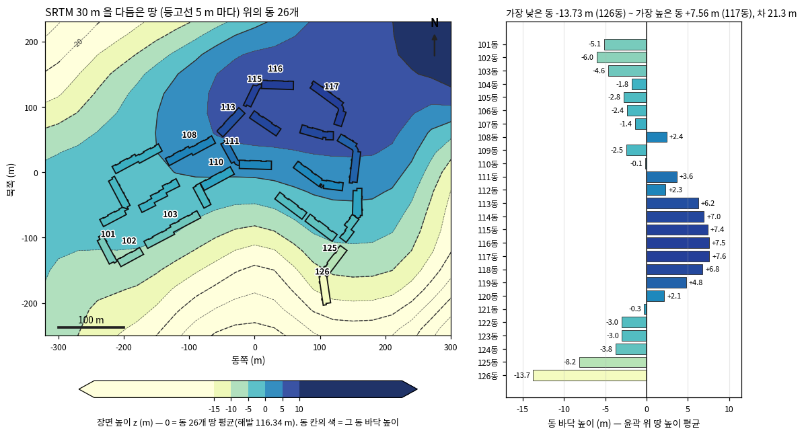

*그림 6. 지형. 왼쪽: 다듬은 SRTM 등고선 위의 동 26개(칸 색 = 바닥 높이). 오른쪽: 동별 바닥 높이(−13.7 … +7.6 m).*

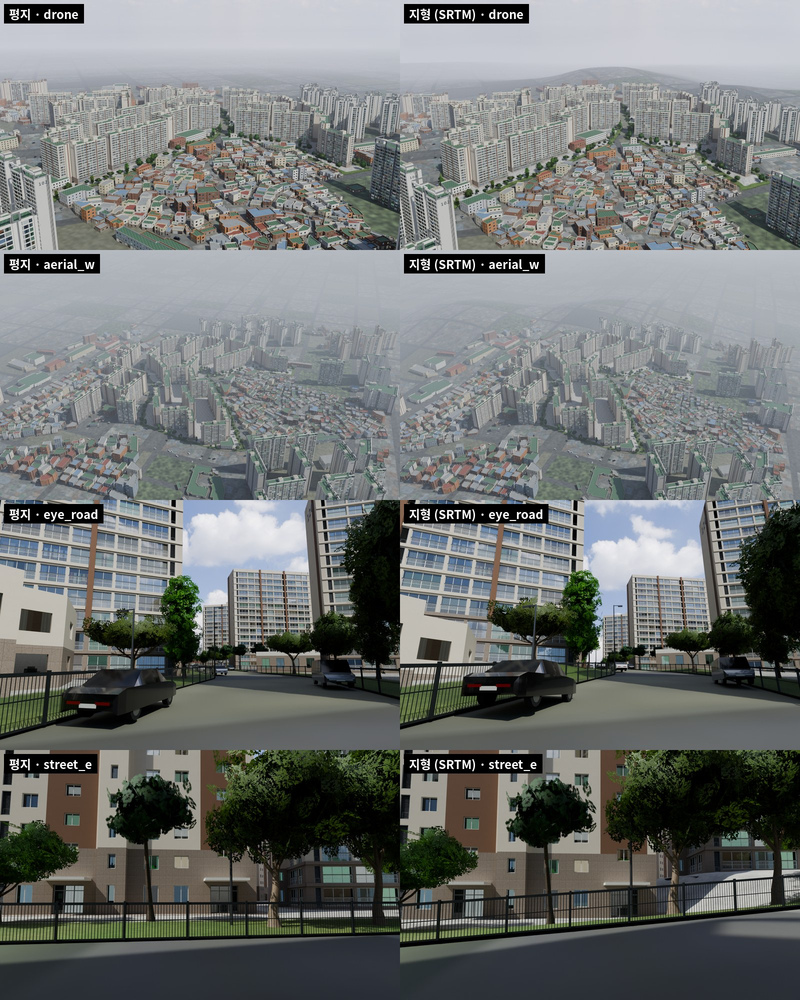

*그림 7. 땅 높이를 넣기 전(평지, 왼쪽)과 넣은 뒤(지형, 오른쪽)의 같은 시점. 땅 높이를 넣으면 북쪽 언덕이 보이고 길과 울타리가 비탈을 따른다.*

## 7. 단지 밖 길 깔기

길 자료를 넣지 않으면 단지 밖은 먼 땅의 도시 무늬뿐이다. 그 반복 격자는 실제 길이 아니고, 동네 골목은 포장 없이 땅 무늬 위에 집만 선다. 그래서 공개 도로 자료로 단지 밖 길을 깔았다.

- **자리:** 길 = 도로 필지 ∪ (필지가 덮지 않는 선형 + 폭) − (건물 윤곽 + 0.4 m) − 단지 안. 도로 필지 197개의 모양과 도로명주소 선 115개의 위치는 공개 자료 그대로다.
- **폭:** 필지가 덮지 않는 선(도로 필지에서 2 m 넘게 벗어난 곳)은 이름 끝말로 폭을 정했다. '길' 4 m · '로' 12 m 이고 이 상자에 '대로' 30 m 는 없다. 이 규칙으로 깐 선은 '길' 4.2 km · '로' 0.44 km 다.
- **넓이:** 도로 필지 107,520 ㎡ + 선형 띠(필지 밖) 24,642 ㎡ − 건물 3,731 ㎡ − 단지 안 1,094 ㎡ → 깔린 길 127,331 ㎡ (항목을 더하고 빼면 6 ㎡ 어긋난다).
- **노면 · 높이:** 아스팔트 한 가지(보도 · 차선 · 연석 없음)를 SRTM 땅 위 0.05 m 에 얹었다.
- **먼 땅:** 길 상자(±420 m) 안의 먼 땅은 20 m 격자에서 5 m 격자로 바꿔 길이 땅에 묻히지 않게 했다. 반경 밖의 가짜 격자 길은 무늬 대비를 0.55 에서 0.25 로 낮춰 희미하게만 남겼다.

**폭 규칙을 고른 까닭.** 선이 도로 필지 안을 지나 자료 폭을 아는 '길' 5.5 km 에서 필지 폭 중앙값은 6.4 m(사분위 4.3–14.4 m)이고, 이름 규칙(4 m)의 오차 중앙값은 2.4 m(좁게)다. 양옆 건물까지의 빈 폭으로 정하는 규칙(2.5–8 m)은 오차 중앙값 3.5 m(넓게)였고, 필지가 덮지 않는 '길' 4.2 km 의 73 % 에서 상한 8 m 에 걸려 마당 · 빈 땅까지 포장하게 되므로 쓰지 않았다.

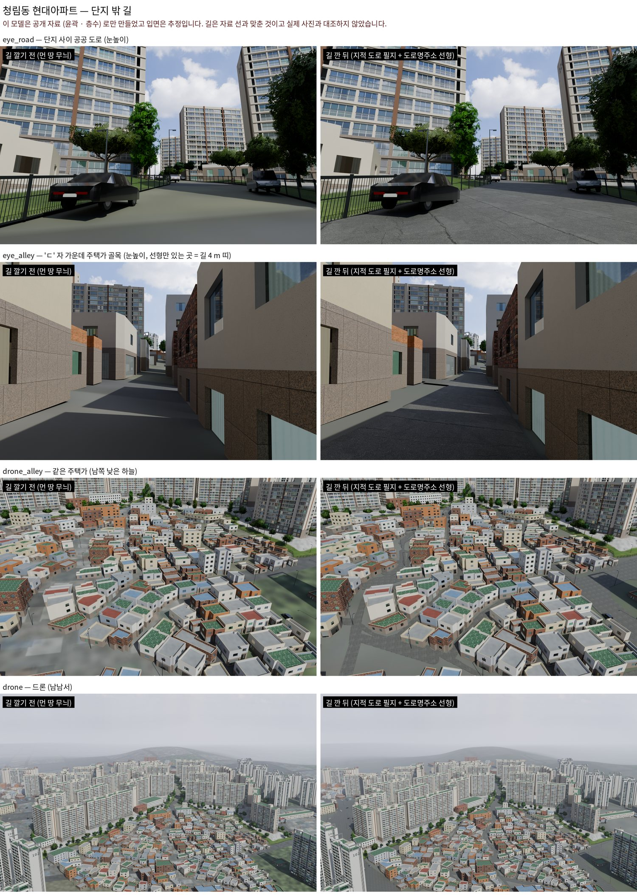

*그림 8. 길을 깔기 전(왼쪽)과 깐 뒤(오른쪽)의 같은 시점 네 쌍: eye\_road · eye\_alley · drone\_alley · drone. 길을 깔면 흐린 땅 무늬 대신 아스팔트가 깔리고 주택가에 골목 그물이 보인다. 골목 4 m 띠와 집 벽 사이에는 먼 땅 무늬가 좁게 남는다.*

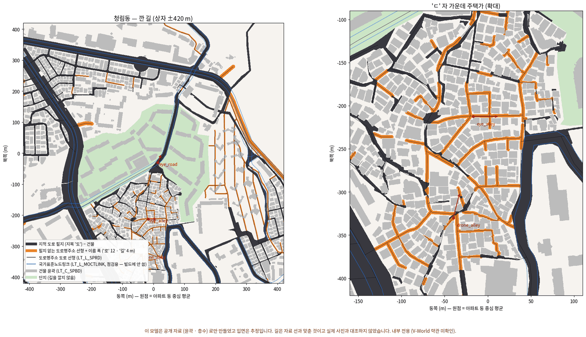

*그림 9. 깐 길 지도(왼쪽 상자 ±420 m, 오른쪽 'ㄷ' 자 가운데 주택가 확대). 검정 = 지적 도로 필지에서 건물을 뺀 곳, 주황 = 필지 없는 도로명주소 선에 이름 끝말 폭, 가는 검정선 = 도로명주소 선, 파랑선 = 노드링크(점검용), 회색 = 건물 윤곽, 연두 = 단지(길을 깔지 않음), 빨간 점 = 렌더 시점.*

## 8. 빛을 구워 웹 뷰어로 묶기

해 · 하늘 빛이 닿는 모습을 Blender 로 미리 계산해 그림(lightmap)으로 저장해 두고, 브라우저는 그 그림을 입혀 그리기만 한다. 이것을 '구운 조명' 이라 한다. 설치 없이 부드럽게 걸어 다니지만 빛은 낮 한 가지로 고정된다.

**시간 · 크기.** 굽기 약 35분(34분 57초), 묶기 8분 49초, 점검까지 연쇄 전체 51분 54초가 걸렸다. 묶음은 118.3 MB(부분 94개, 삼각형 361만, lightmap 20.3 MB)이고 첫 화면은 11.4 MB(+ 땅 높이 지도 2.2 MB)다. 10 Mbps 에서 첫 화면 14.1초 · 다 받기 100.7초, 50 Mbps 에서 4.3초 · 25.1초다.

**길과 시작 자리.** 길의 lightmap 은 따로 구웠다(35칸, 굽는 밀도 중앙값 0.132 m/텍셀). 땅 높이 지도에 길을 넣어 걸을 때 발밑이 그린 길 면과 같다. 시작 자리 3 · 4 는 주택가이고 첫 화면은 개관(5)이다.

**보는 법.** 화면을 한 번 누르고 `W A S D` 로 걷는다. `Tab` 은 걷기와 둘러보기, `1`–`5` 는 시작 자리(1 = 112동 남동쪽, 2 = 112동 북쪽, 3 = 주택가 골목, 4 = 주택가 낮은 하늘, 5 = 위에서 본 개관), `H` 는 도움말이다.

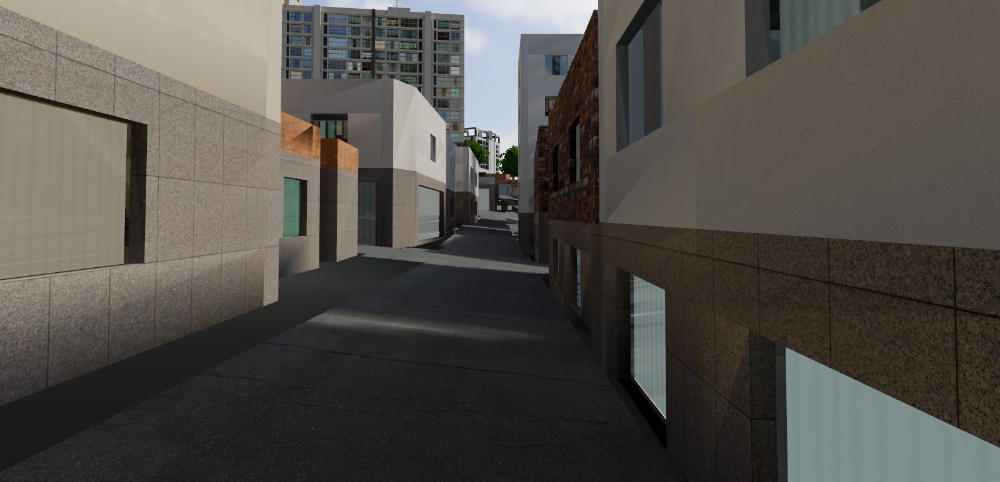

*그림 10. 뷰어 화면(시작 자리 3, 주택가 골목 눈높이). 구운 아스팔트에 집 그림자가 진다. 뷰어 위쪽 가운데에는 공개 자료로만 만들었고 입면 · 땅 높이 · 길은 추정이라는 문구가 늘 나온다(그림에서는 잘라 냈다).*

## 검증 — 한 것과 못 한 것

**한 것**

1. **윤곽 대 모델(IoU).** 만든 동의 옥상 평면을 쓴 윤곽과 겹쳐 쟀다. IoU 중앙값 0.98(최저 0.97), 넓이 비 1.00–1.03 이다. IoU 는 땅 높이와 길을 넣기 전의 장면에서 쟀다. 땅 높이와 길을 넣어도 동 평면 · 층수 · 높이는 그대로임을 확인했다.
2. **위성사진 눈 확인.** 두 윤곽이 크게 다른 동 7곳을 위성사진 위에서 골랐다(3단계).
3. **뷰어 점검.** GPU 컴퓨터에서 6가지 조건으로 31–32항목이 모두 통과했고 실패는 0 이다(화면이 까맣지 않은지, 걷다가 동 26개의 벽 95면에서 모두 멈추는지 등). 뷰어가 도는지를 본 것이지 건물이나 길이 맞는지가 아니다. 길 위 시작 자리 셋의 점검 화면을 눈으로 보니 구운 아스팔트에 집 그림자가 지고 길이 땅에 묻히거나 뜬 곳은 보이지 않았다.
4. **독립 이음 점검.** 속성 · 위치 · 이름으로 도형과 대장을 잇는 다른 방법으로 돌렸더니 동 26개가 모두 이어지고 층수도 대장과 같았다. 목록 · 층수의 확인이지 윤곽 위치의 확인은 아니다.
5. **길 점검.** 깐 길 면을 도로 자료의 선과 견주고 메시 · 높이를 검사했다(표는 아래).

**IoU 를 읽는 법.** 모델은 입력 윤곽을 거의 따른다(0.97–0.99). 그런데 *쓰지 않은* 쪽 윤곽과는 중앙값 0.74(0.00–0.91)이고 0.5 미만이 6동이다(그림 11). 두 공개 자료가 1–5 m 다르다는 뜻이고 어느 쪽이 실제에 가까운지는 눈으로만 가렸다. 0.98 은 "입력을 잘 따랐다" 이지 "실제와 98 % 같다" 가 아니다.

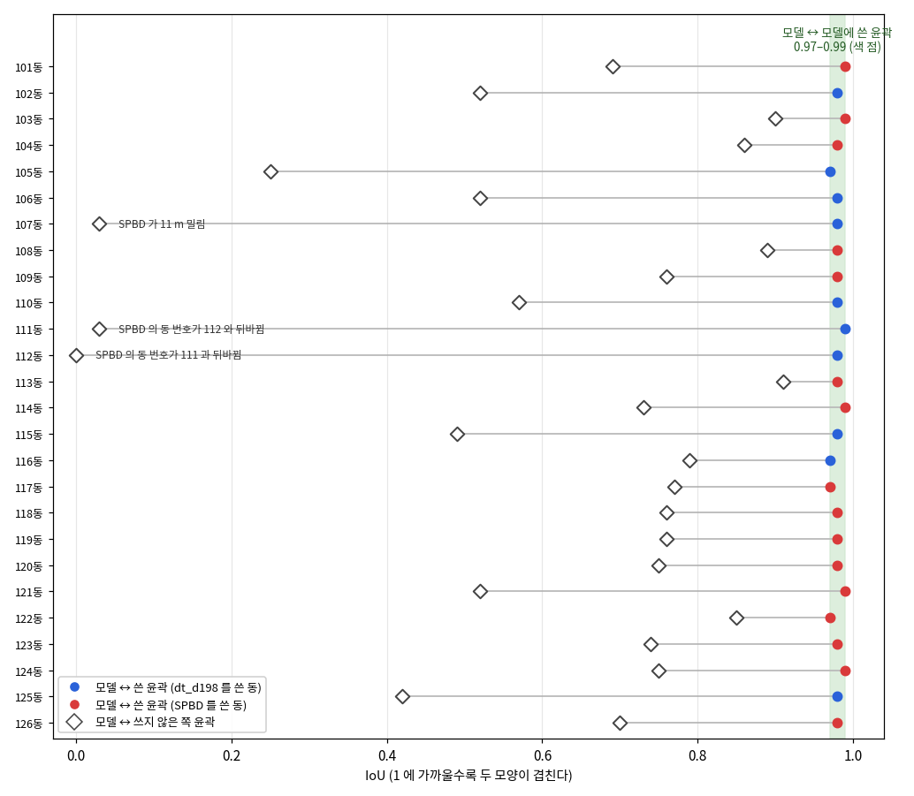

*그림 11. 동별 IoU. 색 점 = 모델 대 쓴 윤곽(0.97–0.99), 마름모 = 모델 대 쓰지 않은 쪽 윤곽(0.00–0.91).*

**길 점검 수치.** '길 면 위' 는 깐 길 면(아스팔트) 위에 놓인 선의 길이 비율이다.

| 항목 | 값 |
| --- | --- |
| 도로명주소 선(반경 420 m, 11.2 km) 중 길 면 위 | 92.3 % (2 m 안 96.7 %). 건물 윤곽 안 1.7 % · 단지 안 2.5 % 는 깔지 않았다 |
| 노드링크 선(6.5 km, 빌드에 안 쓴 교차 확인) 중 길 면 위 | 72.7 % (2 m 안 83.5 %). 단지 안 11.2 % · 건물 안 1.0 % |
| 건물 밑 포장 | 0.0 ㎡ |
| 메시 ↔ 마스크 차이 | 넘침 149 ㎡ · 모자람 113 ㎡ (깔린 길의 0.2 %) |
| 높이: 길 − (SRTM + 0.05 m) | 꼭짓점 ±0.002 m (삼각형 안은 −0.032 … +0.054 m) |
| 높이: 길 − 먼 땅 메시 | 최소 +0.098 m · 중앙값 +0.13 m, 묻힌 곳 0 |
| 길가 차 · 가로등 | 차 140대 중 137대 길 면 위 · 139대 1 m 안, 가로등 120개 중 78개 길 면 위 · 120개 모두 1 m 안 |

**길 점검을 읽는 법.**

- 정확도는 잴 수 없다. 실제 사진 · 측량이 없어 말할 수 있는 것은 '자료 선과 맞는다' 뿐이다.
- 도로명주소 선과의 92 % 는 **같은 자료로 깐 길을 다시 센 값**이라 독립 근거가 아니다. 독립 비교는 노드링크 73 %(2 m 안 84 %)다. 길 면 위가 아닌 27 % 가운데 11 % 는 단지 안(길을 깔지 않은 곳)이고 1 % 는 건물 안이다.

**못 한 것:** 정답 사진이 없어 화면 · 입면 · 높이 · 색의 정확도를 못 쟀다. 윤곽이 실제 자리와 몇 m 어긋났는지, 길이 실제 길과 얼마나 맞는지(자리 · 폭 · 노면)도 못 쟀다.

## 한계와 다음에 할 수 있는 일

**한계**

- 정확도를 못 잰다. 입면 · 옥상 · 색 · 지면은 추측이고 1992년 단지에 맞는지도 모른다. 길도 '공개 자료 선과 맞는다' 까지만 말할 수 있다.
- 동 자리는 1–5 m 다른 두 공개 윤곽 중 고른 것이라 그만큼 불확실하다(107동은 두 자료가 11 m 달라 위성사진으로 골랐다).
- 지형은 30 m 격자를 다듬은 것이다. 옹벽 · 계단 · 단지 안 단차가 없고 건물 · 나무 때문에 몇 m 높게 남았을 수 있다.
- 단지 안 길은 자료가 없어 그대로다(포장 한 가지 + 잔디 띠, 주차장 · 놀이터 없음). 단지 안 '1동' 366 ㎡ 와 이름 없는 176 ㎡ 건물이 무엇인지도 모른다.
- 노면은 아스팔트 한 가지다(보도 · 연석 · 차선 · 횡단보도 없음). 도로 필지는 보도를 포함한 용지라 폭 30 m 안팎 큰길도 아스팔트 한 장으로 보이고, 건물이 든 큰 도로 필지(서쪽)는 건물을 빼고 그 사이를 모두 포장했다. 무늬는 3 m 마다 되풀이된다.
- 골목 폭 4 m 는 이름 끝말 규칙으로 추측한 값이다. 필지 있는 '길' 의 폭 중앙값이 6.4 m 라 띠는 좁은 편이고, 띠와 집 벽 사이에 먼 땅 무늬가 좁게 남는다.
- 길의 lightmap 이 단지 땅보다 거칠다(굽기 0.13 m → 묶음 약 0.26 m/텍셀). 눈높이에서 길 위 그림자 가장자리가 무르다.
- 반경 420 m 밖은 먼 땅 무늬다(대비만 낮췄다). 드론 · 항공 시점 멀리에 희미한 가짜 격자가 남는다.
- 주변 건물 1,006채의 색은 난수이고, 뷰어에서 주변 · 단지 건물은 걸어서 들어갈 수 있다(동 26개는 막힌다).

**다음에 할 수 있는 일**

1. 사진 확보 — 직접 촬영(동마다 앞 · 뒤 · 측벽, 단지 안 길)하면 입면 · 색 · 옥탑을 사진 근거로 바꾸고 정확도를 잴 수 있다(단구2차 방식).
2. V-World 약관을 확인해 그림과 뷰어를 누구에게 보일지 정한다.
3. 단지 안 땅 · 길 나누기(배경지도 판독), 골목 폭 · 옹벽 · 단차 현장 확인, 정체 모르는 건물 두 채 확인.

---

# 부록

## 부록 A. 동별 표 (26동)

층수는 모두 대장 값이다(105–108동은 1000번지 대장에 없어 SPBD · `dt_d198` 값이고, 독립 점검에서 상도동 407 대장과 같음이 확인됐다). '서 있는 필지'는 쓴 윤곽의 중심이 든 지적 필지다. 윤곽 넓이는 쓴 윤곽의 넓이다. IoU 는 땅 높이와 길을 넣기 전에 쟀다(동 평면은 그대로다). 바닥 높이는 동마다 둔 단의 높이(윤곽 위 땅 평균)다. 0 = 동 26개 땅 평균이다.

| 동 | 층 | 층수 근거 | 서 있는 필지 | 윤곽 | 윤곽 넓이(㎡) | 대장 건축면적(㎡) | 바닥 높이(m) | IoU 쓴 윤곽 / 다른 쪽 |
| --: | --: | --- | --- | --- | --: | --: | --: | --: |
| 101 | 15 | 대장 = 윤곽 자료 | 봉천동 1000 | SPBD | 519 | 452 | -5.1 | 0.99 / 0.69 |
| 102 | 15 | 대장 = 윤곽 자료 | 봉천동 1000 | dt\_d198 | 472 | 392 | -6.0 | 0.98 / 0.52 |
| 103 | 15 | 대장 = 윤곽 자료 | 봉천동 1000 | SPBD | 1123 | 953 | -4.6 | 0.99 / 0.90 |
| 104 | 15 | 대장 = 윤곽 자료 | 봉천동 1000 | SPBD | 850 | 715 | -1.8 | 0.98 / 0.86 |
| 105 | 15 | SPBD · dt\_d198 (1000번지 대장에 없음) | 상도동 407 | dt\_d198 조각 | 500 | 없음 | -2.8 | 0.97 / 0.25 |
| 106 | 15 | SPBD · dt\_d198 (1000번지 대장에 없음) | 상도동 407 | dt\_d198 조각 | 578 | 없음 | -2.4 | 0.98 / 0.52 |
| 107 | 15 | SPBD · dt\_d198 (1000번지 대장에 없음) | 상도동 407 | dt\_d198 | 945 | 없음 | -1.4 | 0.98 / 0.03 |
| 108 | 15 | SPBD · dt\_d198 (1000번지 대장에 없음) | 상도동 407 | SPBD | 947 | 없음 | +2.4 | 0.98 / 0.89 |
| 109 | 15 | 대장 = 윤곽 자료 | 봉천동 1000 | SPBD | 440 | 377 | -2.5 | 0.98 / 0.76 |
| 110 | 15 | 대장 = 윤곽 자료 | 봉천동 1000 | dt\_d198 | 669 | 548 | -0.1 | 0.98 / 0.57 |
| 111 | 15 | 대장 = 윤곽 자료 | 봉천동 1000 | dt\_d198 | 437 | 395 | +3.6 | 0.99 / 0.03 |
| 112 | 15 | 대장 = 윤곽 자료 | 봉천동 1000 | dt\_d198 | 617 | 522 | +2.3 | 0.98 / 0.00 |
| 113 | 15 | 대장 = 윤곽 자료 | 봉천동 1000 | SPBD | 626 | 525 | +6.2 | 0.98 / 0.91 |
| 114 | 15 | 대장 = 윤곽 자료 | 봉천동 1000 | SPBD | 628 | 522 | +7.0 | 0.99 / 0.73 |
| 115 | 15 | 대장 = 윤곽 자료 | 봉천동 1000 | dt\_d198 조각 | 411 | 383 | +7.4 | 0.98 / 0.49 |
| 116 | 13 | 대장 = 윤곽 자료 | 봉천동 1000 | dt\_d198 조각 | 609 | 525 | +7.5 | 0.97 / 0.79 |
| 117 | 15 | 대장 (SPBD 는 '1' 로 틀림) | 봉천동 1001 | SPBD | 987 | 870 | +7.6 | 0.97 / 0.77 |
| 118 | 15 | 대장 (SPBD 는 '1' 로 틀림) | 봉천동 1001 | SPBD | 622 | 526 | +6.8 | 0.98 / 0.76 |
| 119 | 15 | 대장 (SPBD 는 '1' 로 틀림) | 봉천동 1001 | SPBD | 944 | 820 | +4.8 | 0.98 / 0.76 |
| 120 | 15 | 대장 (SPBD 는 '1' 로 틀림) | 봉천동 1001 | SPBD | 967 | 797 | +2.1 | 0.98 / 0.75 |
| 121 | 15 | 대장 (SPBD 는 '1' 로 틀림) | 봉천동 1001 | SPBD | 580 | 450 | -0.3 | 0.99 / 0.52 |
| 122 | 15 | 대장 (SPBD 는 '1' 로 틀림) | 봉천동 1001 | SPBD | 487 | 392 | -3.0 | 0.97 / 0.85 |
| 123 | 15 | 대장 (SPBD 는 '1' 로 틀림) | 봉천동 1001 | SPBD | 645 | 548 | -3.0 | 0.98 / 0.74 |
| 124 | 15 | 대장 (SPBD 는 '1' 로 틀림) | 봉천동 1001 | SPBD | 656 | 548 | -3.8 | 0.99 / 0.75 |
| 125 | 15 | 대장 (SPBD 는 '1' 로 틀림) | 봉천동 1001 | dt\_d198 | 647 | 522 | -8.2 | 0.98 / 0.42 |
| 126 | 13 | 대장 (SPBD 는 '1' 로 틀림) | 봉천동 1001 | SPBD | 537 | 463 | -13.7 | 0.98 / 0.70 |

## 부록 B. 용어

- **V-World:** 국토교통부의 공간정보 오픈 플랫폼(지도 · 건물 윤곽 · 지적 API).
- **SPBD(`LT_C_SPBD`):** V-World 의 도로명주소 건물 레이어. **`dt_d198`:** V-World 의 건물통합정보 레이어(건축물대장 정보가 붙은 건물 윤곽).
- **건축HUB · 건축물대장:** 건물 한 동마다 층수 · 면적 · 세대수를 적은 공문서와 그 조회 서비스. **K-apt:** 공동주택 단지 기본정보 서비스.
- **윤곽(footprint):** 건물을 위에서 본 바닥 모양. **IoU:** 두 모양의 겹친 넓이 ÷ 합친 넓이.
- **spec:** 단지 하나를 어떻게 만들지 적은 설정 파일(설계도). **빌더(apt3d):** spec 으로 3D 장면을 만드는 프로그램.
- **절차적 생성:** 규칙(코드)으로 모양을 만들어 내는 방식. **Blender:** 3D 제작 · 렌더 프로그램. **glb:** 3D 모델 표준 파일.
- **SRTM:** NASA 가 2000년 2월에 잰 전 지구 고도 자료. **구운 조명:** 빛 계산을 미리 해서 그림으로 저장해 두는 방식(lightmap).
- **도로 필지:** 지적도에서 지목이 '도'(도로)인 필지. 보도까지 포함한 도로 용지다. **SPRD 선형(`LT_L_SPRD`):** 도로명주소 도로의 선 모양. 속성은 도로 이름뿐이고 폭이 없다. **노드링크(`LT_L_MOCTLINK`):** 국가표준노드링크, 도로를 선(링크)과 교차점(노드)으로 나타낸 자료. 이번에는 빌드에 쓰지 않고 깐 길과 견주는 교차 확인에만 썼다.
